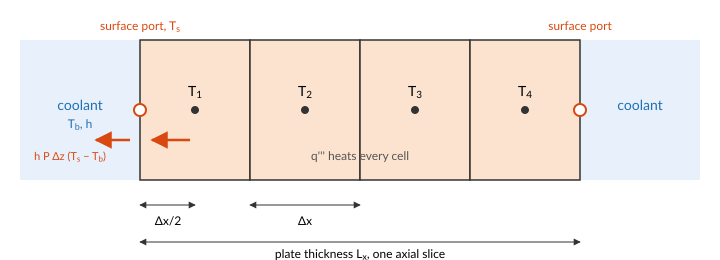

# Heat conduction in fuel

The heat fuel generates has to conduct to its surface before the coolant can take it.
[`HeatDiffusion`](@ref STREAM.Components.HeatDiffusion) models this for two shapes: a plate,
described by a [`Slab`](@ref STREAM.Components.Slab), and a rod or an annulus, described by a
[`Cylinder`](@ref STREAM.Components.Cylinder). Either is cut into a 2D mesh of cells, across
the fuel and along it, and each cell can be a different [`Solid`](@ref).

## The heat equation

Heat in a solid flows down the temperature gradient, at a rate set by the conductivity
``κ``: Fourier's law, ``\mathbf{q}'' = -κ\,\nabla T``. Energy conservation in a small volume
says its stored heat changes by what conducts in, less what conducts out, plus what it
generates at the volumetric rate ``q'''``:

```math
ρ\,c_p\,\frac{\partial T}{\partial t} = -\nabla\cdot\mathbf{q}'' + q'''
= \nabla\cdot(κ\,\nabla T) + q'''.
```

Fuel is thin across and long along. A plate is about a millimetre thick and hundreds of
millimetres long; a temperature difference across its thickness drives heat through a path a
few hundred times shorter, and a few hundred times wider, than the same difference along its
length, so conduction across the fuel outweighs conduction along it by the square of that
ratio. By default each axial slice conducts across only, and the slices are independent.
`axial=true` adds conduction along the fuel, which matters where the axial temperature
gradient is steep: at the ends of the heated length, or beside a partly inserted control
rod.

## Finite volumes

Integrating the heat equation over a cell turns the divergence into the heat flowing through
the cell's faces. Each cell's temperature, at its centre, then obeys

```math
ρ\,c_p\,V\,\frac{dT}{dt} = \sum_f \frac{A_f\,(T_f - T)}{R_f} + P\,s,
```

where the sum runs over the cell's faces, ``A_f`` is a face's area, ``T_f`` the temperature
on its far side, ``P`` the total power and ``s`` the cell's share of it, the `power_shape`.



``R_f`` is the thermal resistance per unit area between the two centres. Each cell
contributes the half of its width that lies on the face's side, over its own conductivity,
and a contact between them adds its own resistance ``1/h``:

```math
R_f = \frac{Δx_a}{2\,κ_a} + \frac{1}{h_f} + \frac{Δx_b}{2\,κ_b}.
```

This is what lets the materials differ from cell to cell. The heat crossing a face between
meat and cladding meets the meat's resistance over half the meat cell and the cladding's
over half the cladding cell, in series, which is exact for a steady flux. With perfect
contact, ``h = ∞``, the middle term vanishes. A finite ``h`` stands for a real interface: the
gas gap between a fuel pellet and its cladding, or an imperfect bond between meat and clad.

A face on the outside of the fuel is a port. Its resistance is the outer cell's half width
alone, and ``T_f`` is the temperature of the [`ThermalPort`](@ref STREAM.Components.ThermalPort)
there. The fuel does not decide that temperature. A coolant channel shares the port, and
states the convective heat flow through it, ``h\,P_h\,Δz\,(T_s - T_b)``; the connection makes
the two heat flows cancel. The solver finds the surface temperature at which conduction to
the surface equals convection away from it.

A port left unconnected carries no heat, so it is adiabatic. For that balance to describe one
surface, a plate's width ``y`` must be the heated width of the channel face it touches.
[`symmetric_plate`](@ref STREAM.Assemblies.symmetric_plate), [`plate`](@ref STREAM.Assemblies.plate)
and [`fuel_assembly`](@ref STREAM.Assemblies.fuel_assembly) join a plate to its channels,
cell by cell, and need it to have as many axial cells as the channels have.

### Plates and rods

The two shapes differ only in their areas and volumes. A slab cell between ``x_j`` and
``x_{j+1}`` and between ``z_i`` and ``z_{i+1}`` has

```math
A_x = y\,Δz, \qquad A_z = y\,Δx, \qquad V = y\,Δx\,Δz.
```

A cylinder cell, a ring between radii ``r_j`` and ``r_{j+1}``, has

```math
A_r = 2π\,r\,Δz, \qquad A_z = π\left(r_{j+1}^2 - r_j^2\right), \qquad
V = π\left(r_{j+1}^2 - r_j^2\right) Δz.
```

The radial face area grows with the radius, which is what gives a rod its logarithmic and
parabolic temperature profiles. A cylinder whose radii start at zero is a solid rod: its axis
has no area, carries no heat, and has no port. Any other cylinder is an annulus, with a port
on each wall.

### Time scales

Two time scales follow. Heat crosses a distance ``ℓ`` of fuel in about ``ℓ^2/α``, with
``α = κ/(ρ c_p)`` the diffusivity: a few milliseconds across half an aluminium plate a
millimetre thick, and seconds across a ceramic pellet. Draining the fuel's stored heat
through the coolant film takes about ``ρ c_p ℓ / h``. For a plate at a forced-convection
``h`` that is a few tenths of a second. It is what sets how quickly a plate follows its power
in a transient.

## A plate against the exact solution

A uniformly heated plate with both faces held at the same temperature ``T_s`` has a parabolic
steady temperature profile:

```math
T(x) = T_s + \frac{q'''}{2κ}\left(\frac{L_x^2}{4} - x^2\right),
\qquad T_\text{centre} = T_s + \frac{q'''\,L_x^2}{8\,κ}.
```

```@example conduction
using STREAM, CairoMakie
using STREAM.Components: HeatDiffusion, Slab, Cylinder, ConstantTemperature
using STREAM.Assemblies: faces
using ModelingToolkit: @named, mtkcompile

Lx, Lz, y, κ, nx = 1.27e-3, 0.6, 0.063, 180.0, 10
P = 2.0e4                                 # plate power [W]
T_s = 60.0                                # both faces [°C]
slab = Slab(; x=range(0.0, Lx; length=nx + 1), z=[0.0, Lz], y,
            material=Solid(2700.0, 900.0, κ))
@named fuel = HeatDiffusion(slab; power=P)
@named left = ConstantTemperature(T_s; n=1)
@named right = ConstantTemperature(T_s; n=1)
connections = faces((left, :thermal) => (fuel, :thermal_left),
                    (right, :thermal) => (fuel, :thermal_right))
@named held = assembly(connections, fuel, left, right)
sys = mtkcompile(held)
sol = solve_steady(sys)

q3 = P / (Lx * Lz * y)
x = ((1:nx) .- 0.5) .* Lx ./ nx .- Lx / 2
T_exact(x) = T_s + q3 / (2κ) * (Lx^2 / 4 - x^2)

fig = Figure(size=(700, 400))
ax = Axis(fig[1, 1]; xlabel="position across the plate [mm]", ylabel="temperature [°C]")
xs = range(-Lx / 2, Lx / 2; length=100)
lines!(ax, xs .* 1e3, T_exact.(xs); label="exact")
scatter!(ax, x .* 1e3, [sol[sys.fuel.T[1, j]] for j in 1:nx]; label="HeatDiffusion cells")
axislegend(ax; position=:cb)
fig
```

The cell temperatures lie on the parabola. The largest difference, in kelvin, is

```@example conduction
deviation = maximum(abs, [sol[sys.fuel.T[1, j]] - T_exact(x[j]) for j in 1:nx])
```

out of a centre-to-surface difference of

```@example conduction
q3 * Lx^2 / (8κ)
```

kelvin. Every cell is off by the same amount, ``q'''Δx^2/(8κ)``. Between two cell centres
the scheme is exact for a parabola; the error comes from the half cell next to each face,
where it takes the temperature as linear and the exact profile still curves. It falls as the
square of the cell width:

```@example conduction
Δx = Lx / nx
@assert isapprox(deviation, q3 * Δx^2 / (8κ); rtol=1e-6)
```

## A rod with a gap

A fuel rod is a ceramic pellet inside a metal tube, with a thin gas gap between them. Heat
made uniformly in the pellet crosses three resistances in series. In the pellet the
temperature is a parabola, in the gap it jumps, and in the cladding, which makes no heat, it
falls logarithmically:

```math
T(r) =
\begin{cases}
T_\text{gap} + \dfrac{q'''\,(R_p^2 - r^2)}{4κ_p}, & r < R_p, \\[2ex]
T_s + \dfrac{q'''\,R_p^2}{2κ_c} \ln\dfrac{R_c}{r}, & R_p < r < R_c,
\end{cases}
\qquad
T_\text{gap} = T_s + \frac{q'''\,R_p^2}{2κ_c}\ln\frac{R_c}{R_p} + \frac{q'''\,R_p}{2h}.
```

The pellet and the cladding are two [`Solid`](@ref)s, one per ring, and the gap is a contact
conductance on the face between them, `r_contacts`:

```@example conduction
R_p, R_c = 4.1e-3, 4.75e-3                # pellet and cladding radii [m]
κ_p, κ_c, h_gap = 3.0, 16.0, 5.0e3        # [W/(m·K)], [W/(m·K)], [W/(m²K)]
q3_rod, T_wall = 3.0e8, 300.0             # [W/m³], [°C]

r = [range(0.0, R_p; length=21); range(R_p, R_c; length=6)[2:end]]
pellet = permutedims(r[2:end] .<= R_p)               # 1 × 25: which rings are pellet
pellet_ring, clad_ring = Solid(10_400.0, 300.0, κ_p), Solid(6_500.0, 330.0, κ_c)
rod = Cylinder(; r, z=[0.0, 1.0], material=ifelse.(pellet, pellet_ring, clad_ring),
               r_contacts=ifelse.(permutedims(r .== R_p), h_gap, Inf))
shape = pellet .* permutedims(diff(r .^ 2))          # uniform in the pellet, none in the clad
@named fuel = HeatDiffusion(rod; power=q3_rod * π * R_p^2, power_shape=shape ./ sum(shape))
@named wall = ConstantTemperature(T_wall; n=1)
@named held = assembly(faces((wall, :thermal) => (fuel, :thermal_right)), fuel, wall)
sys = mtkcompile(held)
sol = solve_steady(sys)

T_clad(r) = T_wall + q3_rod * R_p^2 / (2κ_c) * log(R_c / r)
T_gap = T_clad(R_p) + q3_rod * R_p / (2h_gap)
T_rod(r) = r > R_p ? T_clad(r) : T_gap + q3_rod * (R_p^2 - r^2) / (4κ_p)
centres = (r[1:end-1] .+ r[2:end]) ./ 2

fig = Figure(size=(700, 400))
ax = Axis(fig[1, 1]; xlabel="radius [mm]", ylabel="temperature [°C]")
rs = sort([range(0.0, R_c; length=300); R_p - 1e-9; R_p + 1e-9])
lines!(ax, rs .* 1e3, T_rod.(rs); label="exact")
scatter!(ax, centres .* 1e3, [sol[sys.fuel.T[1, j]] for j in eachindex(centres)];
         label="HeatDiffusion cells")
vlines!(ax, [R_p * 1e3]; color=:gray, linestyle=:dash)
axislegend(ax; position=:lb)
fig
```

The dashed line is the pellet's surface. The jump across the gap, about 120 K, is five
times the drop across the cladding, which is why the gap's conductance weighs so much on a
rod's centre temperature. The cells follow the exact profile, to

```@example conduction
deviation = maximum(abs, [sol[sys.fuel.T[1, j]] - T_rod(centres[j]) for j in eachindex(centres)])
@assert deviation < 1.0
deviation
```

kelvin, out of a centre temperature of

```@example conduction
T_rod(0.0)
```

degrees. As in the plate, the error is the same in every pellet cell: they all sit about a
quarter of a kelvin above the exact parabola, set by the half cells beside the pellet's
surface, and it falls with finer rings.

## What the model leaves out

- **Temperature-dependent properties.** A [`Solid`](@ref) has one density, specific heat and
  conductivity. Ceramic fuel conducts markedly worse when hot, so a rod's centre temperature
  at high power is underestimated by a conductivity taken at a lower temperature.
- **A gap that changes.** A contact conductance is a constant. A real pellet-clad gap closes
  as the pellet swells and heats, and its conductance rises with it.
- **Variation across the width.** Along a plate's width `y`, and around a rod, the
  temperature is single valued, as are the power and the coolant beside it.
- **Radiation and melting.** Heat crosses a gap by conduction only, and the solid stays solid.
